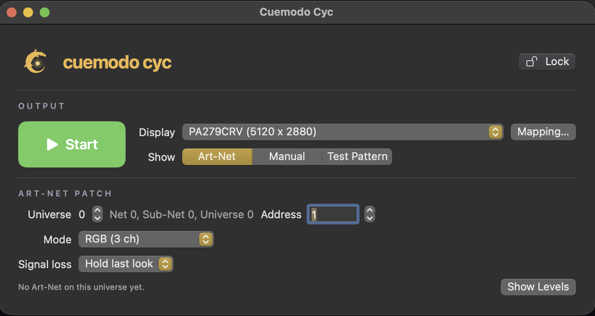
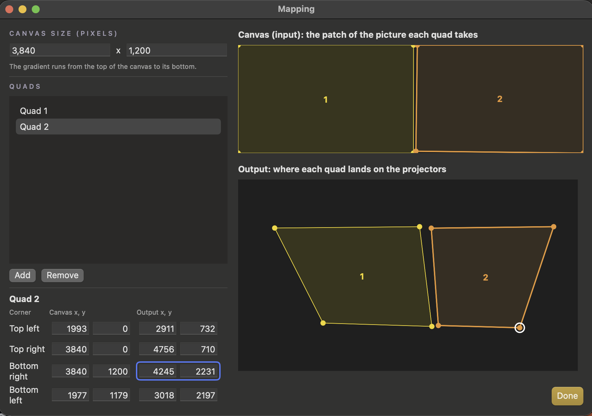

<picture>
  <source media="(prefers-color-scheme: dark)" srcset="docs/images/cuemodo-lockup-horizontal-on-dark.svg">
  
</picture>

# Cuemodo Cyc

Turn projectors into one DMX-controlled light. Cuemodo Cyc is a small macOS app that listens for
Art-Net, behaves like a single fixture (a solid RGB color, or a top-to-bottom gradient like a
theatre cyc), and fills the projector output with that color. A simple quad mapper keeps the light
inside the wash area and stops overlapping projectors from doubling up.

It is light enough to run next to QLab on the same Mac: it only draws when the color changes.

Part of the [Cuemodo](https://cuemodo.io) family of show-control tools. Early development.

## Requirements

- A Mac with macOS 14 (Sonoma) or later, Apple silicon or Intel.
- A lighting desk or app that sends **Art-Net**, on the same network as the Mac (for example a
  Hog 4, or a DMX desk through an Art-Net node).
- The projectors connected to the Mac as a display. Two projectors side by side through a
  splitter (such as a Matrox) count as one wide display.

## Install

1. Download `Cuemodo-Cyc-X.Y.Z.dmg` from the
   [latest release](https://github.com/cuemodo/cyc/releases/latest).
2. Open the DMG and drag **Cuemodo Cyc** onto **Applications**.
3. Open Cuemodo Cyc from Applications. The app is signed and notarized by Apple, so it opens
   without a security warning.

On first launch, macOS may ask:

- To **find and connect to devices on your local network**: click **Allow**. Art-Net arrives over
  the local network; without this, the app receives nothing.
- To **accept incoming network connections** (only if the macOS firewall is on): click **Allow**,
  for the same reason.

You can change both later in System Settings → Privacy & Security → Local Network, and Network →
Firewall.

## Quick start

1. **Output:** pick the projector display under **Display**.
2. **Patch:** under **Art-Net Patch**, set the **Universe**, **Address** and **Mode** to match how
   the fixture is patched on your desk (see [Fixture modes](#fixture-modes)).
3. **Start:** set **Show** to **Art-Net** and click the green **Start** button. The output opens
   full screen on the projectors.
4. Bring up the fixture on the desk. **Show Levels** displays the 512 channels as they arrive, to
   check the desk is reaching the Mac.

**Stop** (or click the output and press Esc) closes the output.

The **Show** choice also offers:

- **Manual:** pick a solid color or a gradient in the app, without a desk. Handy for focusing.
- **Test Pattern:** a grid, for lining up the mapping.

## Fixture modes

Patch Cuemodo Cyc on the desk as a generic LED fixture. Channels count from the address you set.
A dimmer channel (D) scales the color: at 50 % the color keeps its mix but gives half the light.

| Mode | Channels | Layout |
| --- | --- | --- |
| RGB | 3 | red, green, blue |
| DRGB | 4 | dimmer, red, green, blue |
| Gradient RGB | 6 | top red, green, blue, then bottom red, green, blue |
| Gradient DRGB | 8 | top dimmer, red, green, blue, then bottom dimmer, red, green, blue |

The gradient modes blend the top color into the bottom color, like the top lights and ground row
on a theatre cyc. They are two ordinary RGB (or DRGB) blocks in a row, so the desk can patch them
as two generic LED fixtures on consecutive addresses.

The universe is the Art-Net Port-Address counted from 0, like Art-Net itself; the Net, Sub-Net
and Universe it stands for are shown next to it.

## Mapping

Without a mapping, the color fills the whole output. With two projectors, or a wall that is not a
perfect rectangle, open **Mapping…** to draw quads (four-cornered shapes):

- On the **Canvas** side, each quad takes a patch of the picture; the gradient runs from the top
  of the canvas to its bottom.
- On the **Output** side, drag the corners to where that patch should land on the wall.
- Everything outside the quads stays black, which hides light spilling off the wall and the
  doubled brightness where projectors overlap.

Set **Show** to **Test Pattern** while mapping: the grid lines should run straight across the
seam between projectors. Changes appear live on the output, save themselves, and can be undone
with Cmd-Z.

## During the show

- **Lock** (top right) freezes every control, so a stray click or key press changes nothing. It
  stays locked after a relaunch.
- **Signal loss:** if Art-Net stops (desk reboot, cable pulled), Cuemodo Cyc either holds the last
  look (the default) or fades to black after the time you set. The next packet brings the look
  back.
- If the projector display drops out and comes back, the output reopens on it by itself.
- The Mac's display does not sleep while the output is open, and Cmd-Q asks before quitting a live
  output.
- The output window never takes the keyboard, so QLab keeps it.

## Settings

Settings save themselves as you change them. To keep one setup per show, use the **File** menu:
**Save Settings As…** writes a copy, **Open Settings…** loads one, and **New Settings** starts
from defaults. **Show Settings File in Finder** shows where the working copy lives.

## Troubleshooting

- **Show Levels stays at 0:** check the Mac is on the same network and subnet as the desk or
  node (Art-Net often uses 2.x.x.x or 10.x.x.x addresses), the universe matches, and Local
  Network access is allowed (see [Install](#install)).
- **Levels move but the wall doesn't change:** check the **Address** and **Mode** match the
  desk's patch, and **Show** is set to **Art-Net**.
- **Wrong screen goes full screen:** pick the projector under **Display**, then Start again.

## Help and feedback

Found a bug or have an idea? Open an issue on
[GitHub](https://github.com/cuemodo/cyc/issues). To build from source or contribute, see
[CONTRIBUTING.md](CONTRIBUTING.md).

## License

MIT, see [LICENSE](LICENSE).
